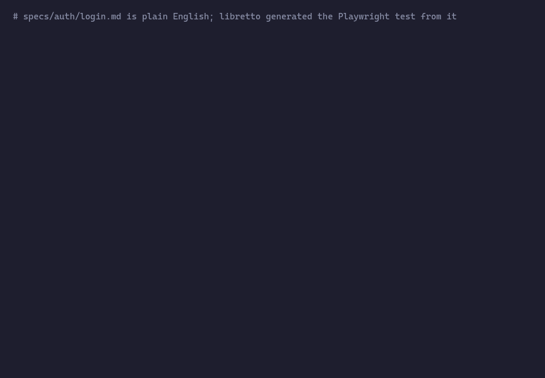

# Libretto

**Write end-to-end tests in plain English. Run them as ordinary Playwright. When one goes red, an agent tells you whether the app or the test is broken.**



<sub>The [login example](examples/login): the suite passes, a build that stops greeting the user by name ships, `run` goes red, and `triage` reproduces the bug in the live app and calls it `app-broken`. Real output; the ~30 s triage pause is shortened.</sub>

## Why Libretto

- **Tests anyone can read.** A spec is a markdown file with `Steps:` and `Expect:` bullets. Product, QA, and engineering review the same file, and each bullet becomes a `test.step`, so a Playwright report reads like the spec.
- **No AI in your CI.** Generated tests are committed TypeScript. `libretto run` is plain Playwright: deterministic, fast, and free. The suite in the GIF runs in under a second.
- **No test is committed until it passes.** Generation runs each test against your app before it writes the file. You never commit a test that has not passed.
- **Red builds come with a diagnosis.** You don't have to work out whether a selector rotted or a real bug shipped. `libretto triage` reads the trace, the screenshot, and the DOM, reproduces the failure in the live app, and returns a verdict with its reasoning.
- **Fixes need your approval.** When the app changed on purpose, `libretto fix` updates the spec or regenerates the code, and asks before it applies anything.
- **Secrets stay out of the model.** `{{env.PASSWORD}}` reaches the browser and `process.env`, never the prompt, the logs, or git.
- **You decide when to spend.** Tokens are spent only when you run `generate`, `triage`, or `fix`, with turn and dollar caps per command. Use an Anthropic API key, your existing Claude login, or GitHub Copilot (experimental).

## How it fits together

Libretto turns each spec into a committed Playwright test, runs the tests without any AI, and when one fails, tells you whether the app or the test is broken and offers to fix the test.

```
specs/*.md ──generate──▶ .libretto/generated/*.generated.spec.ts ──run──▶ results
                                                                          │ failure, when you ask
                                                                          ▼
                                            triage ──▶ app-broken | test-broken | inconclusive
                                                                          │ test-broken, when you ask
                                                                          ▼
                                              fix ──▶ edits the spec, regenerates the test
```

## Install

```sh
pnpm add -D libretto @playwright/test
pnpm add -D @anthropic-ai/claude-agent-sdk   # backend 'claude'
pnpm add -D @github/copilot-sdk              # or backend 'copilot'
pnpm exec playwright install chromium
```

Node 22.18 or later. The Claude backend works with an `ANTHROPIC_API_KEY` or with an existing `claude` CLI login.

## Set up

```ts
// libretto.config.ts
import { defineConfig } from 'libretto'

export default defineConfig({
  baseURL: 'http://localhost:3000',
  specs: 'specs',
  agent: { backend: 'claude', model: 'claude-sonnet-5-5', maxTurns: 40, maxBudgetUsd: 2 },
  generate: { model: 'claude-opus-5-5', maxBudgetUsd: 5 },   // per-command overrides
})
```

`specs/app.md` describes the app as it is now: pages, URLs, naming, anything the agent cannot discover by looking. It is fed to every agent call.

A scenario spec:

```md
---
tags: [smoke]
uses: [logged-in]        # optional fixture, runs first
---
# Login

## Scenario: valid credentials
Steps:
- Open the login page
- Enter username `alice` and password {{env.ALICE_PASSWORD}}
- Click "Log in"

Expect:
- The heading "Welcome, alice" is visible
```

Only `## Scenario:` headings and the `Steps:` / `Expect:` bullet lists are structural; everything else is prose for the agent. A fixture lives in `specs/fixtures/<name>.md`, has `Steps:` only, and becomes a Playwright setup project whose saved session (`storageState`) dependents start from.

## Use

Start your app yourself, then:

```sh
libretto generate          # writes a test for every spec that is new or changed
libretto run               # plain Playwright; writes .libretto/last-run.json
libretto triage            # after a red run: one verdict per failure, in .libretto/triage.json
libretto fix               # proposes spec edits for test-broken verdicts; asks before applying
```

Commit `.libretto/generated/`. Add the rest of `.libretto/` to `.gitignore`.

`run` warns when a spec changed but its test did not. `generate` only regenerates those. A hand-edited generated file is overwritten with a warning that names it.

## How it works

- **Generation is gated.** The agent explores your app through Playwright MCP and submits step bodies, one per bullet. Libretto renders the file (so each bullet becomes a `test.step` with the bullet text as its title), checks it, runs it once against your app, and only then writes it. No committed test has never passed.
- **Secrets never reach the model.** Write `{{env.NAME}}` in a spec and export `NAME`. In the browser the agent types the bare name and Playwright MCP substitutes the value; in generated code it is `process.env.NAME`. Values are redacted from every log and never written to git.
- **Triage reads the evidence.** Trace, failure screenshot, DOM snapshot, and the live app if it is reachable. Verdicts:
  - `app-broken`: the app no longer does what the spec says.
  - `test-broken (spec-wrong)`: the app changed legitimately and the spec is out of date. `fix` edits the spec and regenerates.
  - `test-broken (generated-code-wrong)`: the spec is right, the code is not. `fix` regenerates.
  - `inconclusive`, including when a turn or budget cap was hit.
- **Keep `app.md` current.** When you change the app on purpose, update `app.md`. Triage uses the gap between `app.md` and a scenario to tell `spec-wrong` from `app-broken`.
- **Budgets.** `maxTurns` and `maxBudgetUsd` per command. Copilot has no cost reporting, so `maxBudgetUsd` is a type error under `backend: 'copilot'`.

## Programmatic API

```ts
import { generate, run, triage, fix } from 'libretto'

const result = await run({ specs: ['auth/**'] })
if (result.failures.length) {
  const { records } = await triage()
  for (const r of records) console.log(r.spec, r.verdict.kind, r.verdict.evidence)
}
await fix({ confirm: async (proposal) => proposal.kind === 'regenerate' })
```

`fix` requires `confirm`; there is no way to apply edits silently. Bring your own backend by implementing `AgentRunner` and passing it as `agent`.

## Status

Early. The Claude backend is exercised end to end (see `examples/login`); the Copilot backend is implemented but not yet verified. Known limits: user `playwright.config` `projects` are not multiplied (the first project's `use` is kept, with a warning), and relative paths in that config resolve against `.libretto/`.

## Example

```sh
cd examples/login && pnpm install
ALICE_PASSWORD=s3cret-pass node server.mjs &
ALICE_PASSWORD=s3cret-pass pnpm exec libretto generate
ALICE_PASSWORD=s3cret-pass pnpm exec libretto run
```

Restart the server with `BREAK_APP=1` for an `app-broken` verdict, or `APP_VARIANT=signin` (and update `specs/app.md`) for `spec-wrong`.
